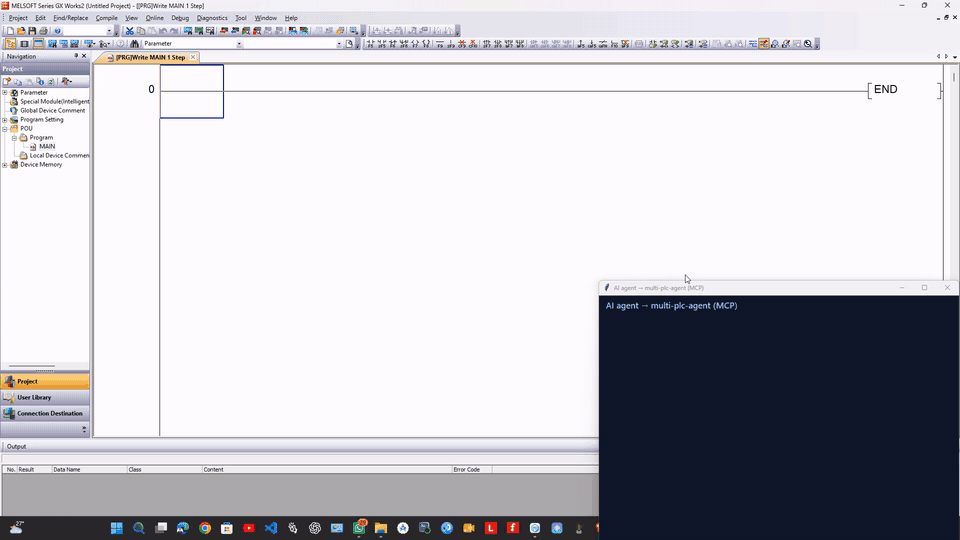
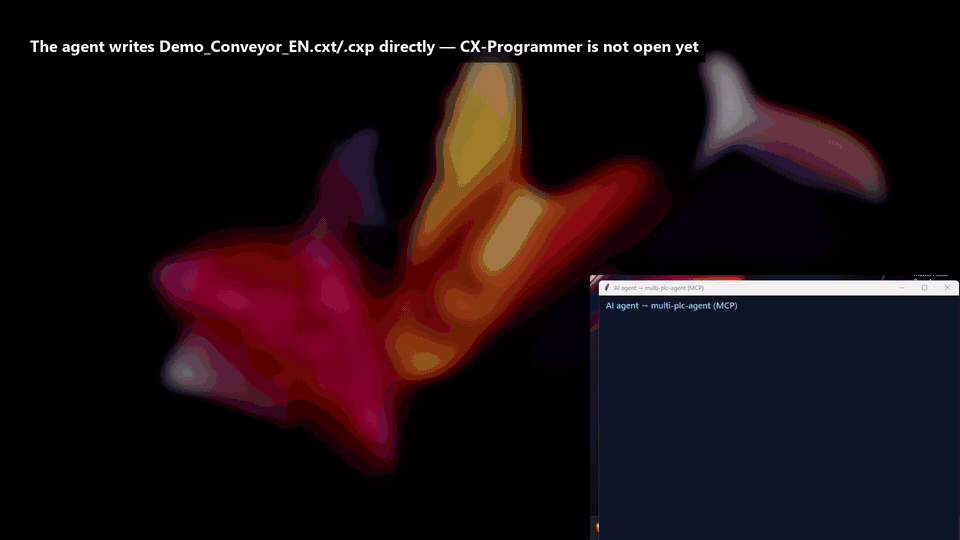
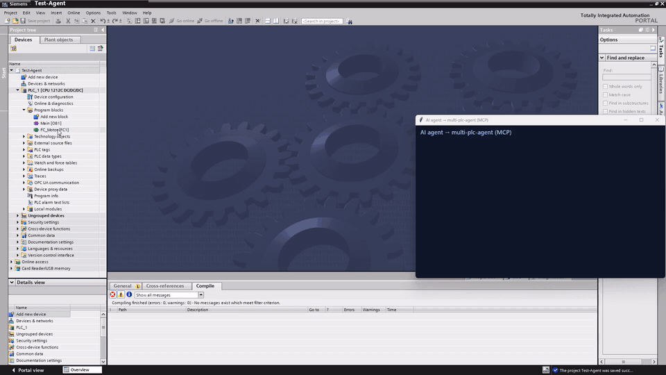
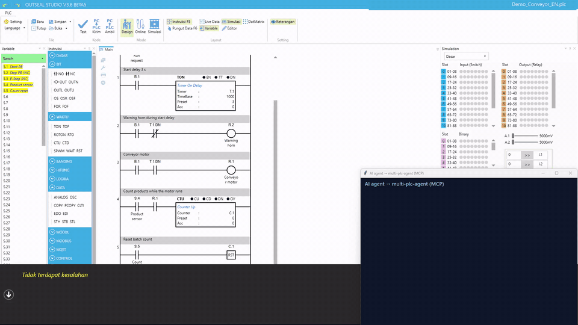
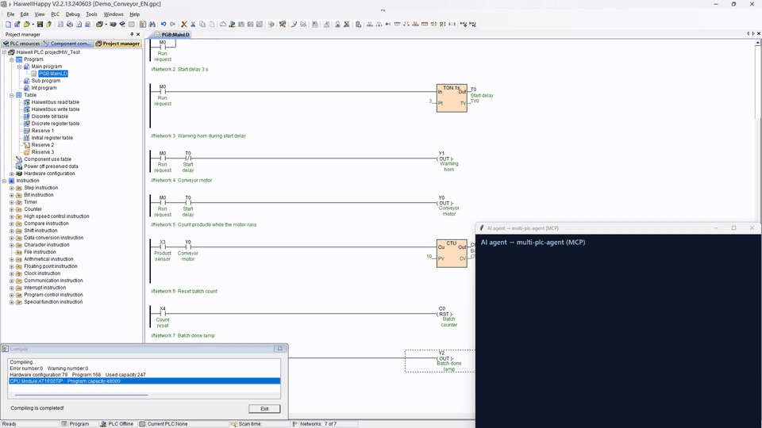
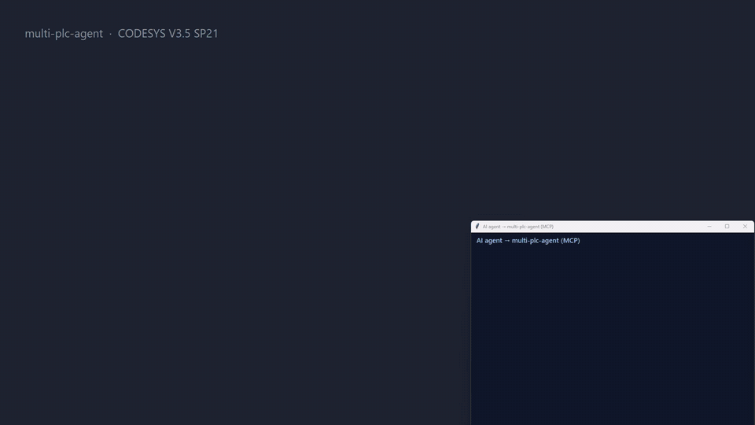

# multi-plc-agent

[English](#english) · [Bahasa Indonesia](#bahasa-indonesia)

---

## English

One MCP server that lets an AI agent write ladder logic in many PLC engineering tools: Mitsubishi GX Works2, Siemens TIA Portal, Omron CX-Programmer and Sysmac Studio, CODESYS, Schneider Machine Expert - Basic, Delta WPLSoft, Outseal Studio and Haiwell Happy.

multi-plc-agent starts one MCP server per tool, gives every tool a vendor prefix (`mitsubishi_`, `siemens_`, `omron_`, `sysmac_`, `codesys_`, `schneider_`, `delta_`, `outseal_`, `haiwell_`) and exposes them as one server. Each backend keeps its own approval flow and safety checks. The router adds one shared rule on top: tools that act on a live PLC or delete project content are not exposed. The GX Works2, TIA Portal and CX-Programmer backends are existing third-party projects; the other backends live in [`backends/`](backends).

Contributions are welcome: see [CONTRIBUTING.md](CONTRIBUTING.md).

### Supported software

| Vendor | Software | Backend | How it writes | Verified on |
| --- | --- | --- | --- | --- |
| Mitsubishi | GX Works2 1.580 and 1.635 | [Wayan123/gxworks-agent](https://github.com/Wayan123/gxworks-agent) (fork of [Arienax/gxworks-agent](https://github.com/Arienax/gxworks-agent)) | Drives the GX Works2 UI: CSV import of the program and device comments | 1.580.0.1 English UI, FX3U: program and comments imported, Check Program "No error found" |
| Siemens | TIA Portal V20 / V21 | [bulaofen0036-coder/TIA_Portal_Openness_MCP](https://github.com/bulaofen0036-coder/TIA_Portal_Openness_MCP) v2.7.8 | Official TIA Openness API: LAD as S7DCL text, timers/counters as SCL external source | V20, S7-1200 1212C: FB + FC + OB1 + tags imported, compile 0 errors / 0 warnings |
| Omron | CX-Programmer 9.x, CP1E | [BlackUppsss/Cx-Proggrammer-MCP](https://github.com/BlackUppsss/Cx-Proggrammer-MCP) | Edits `.cxt`/`.cxp` project files directly | 9.75, CP1E-NA: project opened, compile 0 errors / 0 warnings |
| Omron | Sysmac Studio 1.47 (NX/NJ) | [`backends/sysmac`](backends/sysmac) | Generates IEC 61131-10 XML, imports it with Tools > IEC 61131-10 XML > Import through UI Automation, builds, reads the stored ladder back | 1.47.0.64008, NX1P2-1040DT: 6 rungs imported (new and replaced program), build 0 errors / 0 warnings, read-back matches |
| CODESYS | CODESYS V3.5 SP21 | [`backends/codesys`](backends/codesys) | Official ScriptEngine, headless (`--noUI --runscript`): new project, PLCopen XML LD import, build, export back | 3.5.21.0, Control Win V3 x64: 6 rungs, "Compile complete -- 0 errors, 0 warnings", exported logic matches |
| Schneider | EcoStruxure Machine Expert - Basic 1.3 (M221) | [`backends/schneider`](backends/schneider) | Writes the rungs as IL into the `.smbp` XML project, then compiles in the tool through UI Automation (optional IL → LD conversion by the tool) | 1.3.0.215, TM221M16R: 6 rungs, status "No error", read-back matches |
| Delta | WPLSoft 2.52 (DVP-ES2/SS2) | [`backends/delta`](backends/delta) | Writes the program words into the `.dvp` file, then runs WPLSoft's Instruction ⇄ Ladder compile and saves | 2.52, DVP-SS2: 7 rungs, 0 errors, IL read-back identical |
| Outseal | Outseal Studio 3.6 (Nano / Mega boards) | [`backends/outseal`](backends/outseal) | Writes the `.plc` project file directly, then runs Studio's Test through UI Automation | V.3.6 Beta5, Nano V5: 7 rungs written, Test 0 errors, hex generated; codec round-trips all 18 bundled examples |
| Haiwell | Haiwell Happy 2.2.13 (C/T/N/H series) | [`backends/haiwell`](backends/haiwell) | Types rungs into the LD editor with its keyboard shortcuts, then exports IL and compares it with the expected IL | V2.2.13.240603, AT16S0T/P: 7 rungs written, IL read-back identical, compile 0 errors / 0 warnings |
| Mitsubishi | GX Works3 | none yet | Planned: ladder editor [Edit] → [Import File] CSV | Not supported. On the development machine GX Works3 1.055H crashes on [Project] > [New]; see [ROADMAP.md](ROADMAP.md) |

"Verified on" lists only what was actually run. Other CPUs, versions and UI languages may work, but they have not been tested. Planned tools (Beckhoff TwinCAT, Delta ISPSoft/DIADesigner, Rockwell, Keyence, Inovance, LS and more) are listed in [ROADMAP.md](ROADMAP.md).

### Demo

The agent wrote the same conveyor specification into each tool through this router:

- start/stop with an E-stop
- a 3 s warning horn before the motor starts
- a stop after a batch of 10 products

Each recording is one continuous run: the agent's MCP calls appear in the log window, and the result is then checked in the vendor software. The GIFs play at 1.5× speed. Paths on the development machine are masked.

#### Mitsubishi GX Works2 1.580 (FX3U)

The agent imports 5 rungs and 11 device comments into MAIN, and Check Program reports "No error found".



#### Omron CX-Programmer 9.75 (CP1E-NA)

The agent writes 6 rungs and 9 symbols directly to the `.cxt`/`.cxp` project, which is then opened in CX-Programmer. Compile reports 0 errors and 0 warnings. The desktop is blurred while the agent writes the file, because CX-Programmer is not open yet at that point.



#### Siemens TIA Portal V20 (S7-1200 1212C)

The agent creates 10 tags, an SCL FB for the timer and counter, a LAD FC and OB1 calls, and compile reports 0 errors and 0 warnings. FC_Conveyor and OB1 are then opened in the editor.



#### Outseal Studio 3.6 (Outseal PLC Nano V5)

The agent validates 7 rungs for the Nano V5 I/O range, writes the `.plc` file (read back identical), and Outseal Studio's Test reports 0 errors and builds the hex file.



#### Haiwell Happy 2.2.13 (AT16S0T/P)

The agent types 7 rungs with network and component comments into the LD editor, saves, and the IL exported by Haiwell Happy matches the expected IL line for line. Compile reports 0 errors and 0 warnings.



#### CODESYS V3.5 SP21 (CODESYS Control Win V3 x64)

CODESYS runs headless while the agent creates the project, imports the LD program as PLCopen XML and builds it: "Compile complete -- 0 errors, 0 warnings", and the exported logic matches the request. The project is then opened in CODESYS to review PLC_PRG. The headless build is shown at 4× speed.



Full-length MP4 videos (1080p) are attached to the [releases](https://github.com/Wayan123/multi-plc-agent/releases): `multi-plc-agent-demo.mp4`, `demo-gxworks2.mp4`, `demo-cxprogrammer.mp4` and `demo-tiaportal.mp4` (v0.1.0), `demo-outseal.mp4` and `demo-haiwell.mp4` (v0.2.0), and `demo-codesys.mp4` (v0.3.0). The Sysmac, Schneider and Delta backends have been verified by tool output; recordings will follow.

### Install (Windows)

Install each third-party backend you need by following its own README, then:

```powershell
git clone https://github.com/Wayan123/multi-plc-agent.git
cd multi-plc-agent
py -3 -m pip install .
copy config.example.json config.json
```

The router has no dependencies outside the Python standard library (3.10+). The in-repo backends that drive a desktop program need a Windows Python with `pywinauto` and `pywin32` (`py -3 -m pip install pywinauto pywin32`). The CODESYS backend needs no extra packages.

Edit `config.json`, or set the variables it refers to:

| Variable | Points to |
| --- | --- |
| `GXWORKS_AGENT_DIR` | gxworks-agent checkout with its `.venv-mcp` |
| `TIA_MCP_DIR` | extracted `TIA_MCP_Delivery_v*` folder |
| `CX_MCP_DIR` | Cx-Proggrammer-MCP checkout with its `.venv` |
| `CX_PROJECT` | the `.cxt` file the Omron CX-Programmer backend edits |
| `MULTIPLC_DIR` | this checkout (for the in-repo backends) |
| `GUI_PYTHON` | Windows `python.exe` with `pywinauto` and `pywin32` |

Set `"enabled": false` on any backend you don't use. Check that every backend starts:

```powershell
multi-plc-agent --config config.json --check
```

The command exits with 0 only when every enabled backend reports `running`.

### Connect an MCP client

```json
{
  "mcpServers": {
    "multi-plc": {
      "command": "multi-plc-agent",
      "args": ["--config", "C:\\path\\to\\config.json"]
    }
  }
}
```

Ask the agent to call `list_plc_backends` first. It returns each backend's status, server identity, exposed tool count and the tools that were withheld.

### What is not exposed

| Backend | Withheld by default | Why |
| --- | --- | --- |
| Siemens | `DownloadToPlc`, `GoOnline`, `SetWatchTableModifyValue`, every `Delete*`, `ClearExports`, `EnsureOpennessUserGroup`, `Doctor` | Live PLC writes, deletions, and a group change that runs through UAC |
| Siemens | The same names called through `CallTool` | `CallTool` reaches tools that aren't listed, so the router checks the inner name |
| Omron CX-Programmer | `delete_rung` | Deletion |
| In-repo backends | (nothing to withhold) | They have no tools that go online, download or upload |

To expose a withheld tool on one backend, add `"allow": ["ToolName"]` to it. To withhold more tools, use `"deny"`.

### Per-backend notes

- **GX Works2.** Native compile and live ST/FBD sessions still require 1.635.0.1. On 1.580, only Ladder CSV import and export are enabled. Save the project in GX Works2 yourself, because the tool won't save an unnamed project. The 1.580 support lives in the fork; upstream focuses on editing `.gxw` files directly ([Arienax/gxworks-agent#11](https://github.com/Arienax/gxworks-agent/pull/11)).
- **TIA Portal.** Add your Windows user to the `Siemens TIA Openness` group yourself and sign in again before the first start. Otherwise the server tries to do it through UAC and exits if that fails. TIA Portal asks for Openness access on every connect unless you choose "Yes to all".
- **CX-Programmer.** The backend edits one project file, set by `--project`. Close the project in CX-Programmer before the agent commits. If it was open, close it **without saving** and reopen it. The backend was written for CP1E. Its address and instruction checks do not cover CP1L, CP1H, CJ or CS.
- **Sysmac Studio.** Started by the backend with `-elevate`, which keeps Sysmac in the normal user session so UI Automation works (a plain launch restarts itself as Administrator, and then nothing can automate it). It writes into the open project, or creates an NX1P2 project if none is open. Read-back parses Sysmac's stored ladder listing, observed on 1.47. Map I/O to variables yourself. About 1 minute per write.
- **CODESYS.** Runs CODESYS headless with your installed profile (`--profile`, default `CODESYS V3.5 SP21`); no window appears. Creates a new `.project` per write (an existing file is replaced only with `overwrite=true`, keeping a `.bak`). Variables are named IEC variables, optionally with `%IX`/`%QX` addresses. About 30 s per write. CODESYS 3.5 SP22+ also offers an official, licensed MCP Server add-on; this backend does not need it.
- **Machine Expert - Basic.** Replaces all rungs of the first POU of a `.smbp`. Only the TM221M16R template is bundled; for another M221 save an empty project from the tool and pass its path. `compile` takes about 1 minute (2.5 minutes with `to_ladder`).
- **WPLSoft.** Replaces the whole program of a `.dvp` and adds device comments; rung (segment) comments are not written yet. Only the DVP-SS2 template is bundled. Menus are clicked by position inside WPLSoft's own window, so another version or UI language may need adjustment.
- **Outseal Studio.** `outseal_write_project` writes the file without the GUI; `outseal_compile` opens it in Outseal Studio and clicks Test. Addresses are checked against the board's I/O count. The backend never uploads to a board.
- **Haiwell Happy.** There is no ladder import, so `haiwell_write_ladder` types into the editor. Don't use the keyboard or mouse while it runs (about 2 minutes for 7 rungs); it stops if another window takes focus. It replaces the first program block and keeps a `.bak` copy. Supported: NO/NC contacts, parallel branches (first leg one contact, no nesting), one output per rung: OUT, SET, RST, TON (1 s base), CTU. Only the AT16S0T/P template is bundled; for other CPUs create the project in Haiwell Happy and pass its path.

Backends that drive a desktop program run one call at a time. Don't run two GUI backends at once on the same desktop.

### Safety

Generated ladder logic is a draft. Review it and test it in a simulator (GX Simulator2, PLCSIM, CX-Simulator, CODESYS Control Win, the M221 simulator, Haiwell Happy's offline simulator) before it reaches equipment. Emergency stop, guarding, two-hand control and overload protection must be implemented by independent safety hardware, not by AI-generated logic.

### Development

```powershell
py -3 -m pip install pytest
py -3 -m pytest tests backends -q
```

The router tests start fake stdio backends. The backend tests check file formats, validation, code generation and read-back comparison. None of them need PLC software. Set `OUTSEAL_SAMPLES` to a folder of Outseal Studio `.plc` files to round-trip them too.

### Contributing

New backends, verification on other versions and translations are welcome. Read [CONTRIBUTING.md](CONTRIBUTING.md) first: commits need a DCO sign-off (`git commit -s`), and vendor manuals, DLLs, sample projects and customer data must never be committed. Report security issues privately ([SECURITY.md](SECURITY.md)).

### License

Apache-2.0, see [LICENSE](LICENSE). The GX Works2, TIA Portal and CX-Programmer backends are separate projects under their own licenses, see [NOTICE](NOTICE); this repository does not include or redistribute their code. The backends in `backends/` are part of this repository and under its license. The bundled templates are empty projects saved by a contributor, with vendor preset texts removed. Vendor product names are trademarks of their owners; this project is not affiliated with any vendor, and you need your own licensed installation of each tool.

---

## Bahasa Indonesia

Satu server MCP yang membuat agen AI bisa menulis program ladder di banyak software engineering PLC: Mitsubishi GX Works2, Siemens TIA Portal, Omron CX-Programmer dan Sysmac Studio, CODESYS, Schneider Machine Expert - Basic, Delta WPLSoft, Outseal Studio, dan Haiwell Happy.

multi-plc-agent menjalankan satu server MCP per software, memberi setiap tool awalan vendor (`mitsubishi_`, `siemens_`, `omron_`, `sysmac_`, `codesys_`, `schneider_`, `delta_`, `outseal_`, `haiwell_`), lalu menyajikannya sebagai satu server. Setiap backend tetap memakai alur persetujuan dan pemeriksaan keamanannya sendiri. Router menambahkan satu aturan bersama: tool yang bekerja pada PLC yang sedang berjalan atau menghapus isi proyek tidak disajikan. Backend GX Works2, TIA Portal, dan CX-Programmer adalah proyek pihak ketiga; backend lainnya ada di [`backends/`](backends).

Kontribusi sangat diterima: lihat [CONTRIBUTING.md](CONTRIBUTING.md).

### Software yang didukung

| Vendor | Software | Backend | Cara menulis | Diverifikasi di |
| --- | --- | --- | --- | --- |
| Mitsubishi | GX Works2 1.580 dan 1.635 | [Wayan123/gxworks-agent](https://github.com/Wayan123/gxworks-agent) (fork dari [Arienax/gxworks-agent](https://github.com/Arienax/gxworks-agent)) | Mengendalikan UI GX Works2: import CSV program dan komentar device | 1.580.0.1 UI Inggris, FX3U: program dan komentar masuk, Check Program "No error found" |
| Siemens | TIA Portal V20 / V21 | [bulaofen0036-coder/TIA_Portal_Openness_MCP](https://github.com/bulaofen0036-coder/TIA_Portal_Openness_MCP) v2.7.8 | API resmi TIA Openness: LAD sebagai teks S7DCL, timer/counter sebagai SCL external source | V20, S7-1200 1212C: FB + FC + OB1 + tag masuk, compile 0 error / 0 warning |
| Omron | CX-Programmer 9.x, CP1E | [BlackUppsss/Cx-Proggrammer-MCP](https://github.com/BlackUppsss/Cx-Proggrammer-MCP) | Mengedit file proyek `.cxt`/`.cxp` langsung | 9.75, CP1E-NA: proyek terbuka, compile 0 error / 0 warning |
| Omron | Sysmac Studio 1.47 (NX/NJ) | [`backends/sysmac`](backends/sysmac) | Membuat XML IEC 61131-10, mengimpornya lewat Tools > IEC 61131-10 XML > Import dengan UI Automation, build, lalu membaca balik ladder yang tersimpan | 1.47.0.64008, NX1P2-1040DT: 6 rung masuk (program baru dan pengganti), build 0 error / 0 warning, read-back cocok |
| CODESYS | CODESYS V3.5 SP21 | [`backends/codesys`](backends/codesys) | ScriptEngine resmi tanpa jendela (`--noUI --runscript`): proyek baru, import LD PLCopen XML, build, ekspor balik | 3.5.21.0, Control Win V3 x64: 6 rung, "Compile complete -- 0 errors, 0 warnings", logika hasil ekspor cocok |
| Schneider | EcoStruxure Machine Expert - Basic 1.3 (M221) | [`backends/schneider`](backends/schneider) | Menulis rung sebagai IL ke proyek XML `.smbp`, lalu compile di software lewat UI Automation (konversi IL → LD oleh software, opsional) | 1.3.0.215, TM221M16R: 6 rung, status "No error", read-back cocok |
| Delta | WPLSoft 2.52 (DVP-ES2/SS2) | [`backends/delta`](backends/delta) | Menulis word program ke file `.dvp`, lalu menjalankan compile Instruction ⇄ Ladder di WPLSoft dan menyimpan | 2.52, DVP-SS2: 7 rung, 0 error, read-back IL identik |
| Outseal | Outseal Studio 3.6 (board Nano / Mega) | [`backends/outseal`](backends/outseal) | Menulis file proyek `.plc` langsung, lalu menjalankan Test lewat UI Automation | V.3.6 Beta5, Nano V5: 7 rung, Test 0 error, file hex terbentuk; codec round-trip 18 contoh bawaan |
| Haiwell | Haiwell Happy 2.2.13 (seri C/T/N/H) | [`backends/haiwell`](backends/haiwell) | Mengetik rung di editor LD dengan shortcut keyboard, lalu ekspor IL dan membandingkannya dengan IL yang diharapkan | V2.2.13.240603, AT16S0T/P: 7 rung, read-back IL identik, compile 0 error / 0 warning |
| Mitsubishi | GX Works3 | belum ada | Rencana: editor ladder [Edit] → [Import File] CSV | Belum didukung. Di mesin pengembang GX Works3 1.055H crash saat [Project] > [New]; lihat [ROADMAP.md](ROADMAP.md) |

Kolom "Diverifikasi di" hanya berisi yang benar-benar sudah dijalankan. CPU, versi, dan bahasa UI lain mungkin juga jalan, tetapi belum diuji. Software yang direncanakan (Beckhoff TwinCAT, Delta ISPSoft/DIADesigner, Rockwell, Keyence, Inovance, LS, dan lainnya) ada di [ROADMAP.md](ROADMAP.md).

### Demo

Agen menulis spesifikasi conveyor yang sama ke setiap software lewat router ini:

- start/stop dengan E-stop
- horn peringatan 3 detik sebelum motor jalan
- berhenti setelah satu batch berisi 10 produk

Setiap rekaman adalah satu kali jalan tanpa potongan: pemanggilan MCP oleh agen muncul di jendela log, lalu hasilnya dicek di software vendor. GIF diputar 1,5× lebih cepat. Path di mesin pengembang disamarkan. GIF dan video lengkap ada di bagian [Demo versi bahasa Inggris](#demo) dan di [halaman release](https://github.com/Wayan123/multi-plc-agent/releases), termasuk demo CODESYS (`demo-codesys.mp4`, v0.3.0). Backend Sysmac, Schneider, dan Delta sudah diverifikasi lewat output tool; rekamannya menyusul.

### Instalasi (Windows)

Pasang setiap backend pihak ketiga yang Anda perlukan sesuai README-nya masing-masing, lalu:

```powershell
git clone https://github.com/Wayan123/multi-plc-agent.git
cd multi-plc-agent
py -3 -m pip install .
copy config.example.json config.json
```

Router tidak butuh paket di luar pustaka standar Python (3.10+). Backend di repo ini yang mengendalikan program desktop butuh Python Windows dengan `pywinauto` dan `pywin32` (`py -3 -m pip install pywinauto pywin32`). Backend CODESYS tidak butuh paket tambahan.

Edit `config.json`, atau isi variabel yang dipakainya:

| Variabel | Menunjuk ke |
| --- | --- |
| `GXWORKS_AGENT_DIR` | checkout gxworks-agent beserta `.venv-mcp` |
| `TIA_MCP_DIR` | folder `TIA_MCP_Delivery_v*` hasil ekstrak |
| `CX_MCP_DIR` | checkout Cx-Proggrammer-MCP beserta `.venv` |
| `CX_PROJECT` | file `.cxt` yang diedit backend CX-Programmer |
| `MULTIPLC_DIR` | checkout repo ini (untuk backend di dalam repo) |
| `GUI_PYTHON` | `python.exe` Windows yang sudah terpasang `pywinauto` dan `pywin32` |

Isi `"enabled": false` untuk backend yang tidak dipakai. Cek bahwa setiap backend bisa berjalan:

```powershell
multi-plc-agent --config config.json --check
```

Perintah ini keluar dengan kode 0 hanya jika semua backend yang aktif berstatus `running`.

### Menghubungkan client MCP

Gunakan konfigurasi `mcpServers` yang sama seperti di [versi bahasa Inggris](#connect-an-mcp-client). Minta agen memanggil `list_plc_backends` lebih dulu. Tool ini mengembalikan status setiap backend, identitas server, jumlah tool yang disajikan, dan tool yang ditahan.

### Yang tidak disajikan

| Backend | Ditahan secara default | Alasan |
| --- | --- | --- |
| Siemens | `DownloadToPlc`, `GoOnline`, `SetWatchTableModifyValue`, semua `Delete*`, `ClearExports`, `EnsureOpennessUserGroup`, `Doctor` | Menulis ke PLC, menghapus, dan mengubah grup user lewat UAC |
| Siemens | Nama yang sama lewat `CallTool` | `CallTool` bisa memanggil tool yang tidak terdaftar, jadi router memeriksa nama di dalamnya |
| Omron CX-Programmer | `delete_rung` | Menghapus |
| Backend di repo ini | (tidak ada yang perlu ditahan) | Tidak punya tool untuk online, download, atau upload |

Untuk membuka tool yang ditahan di satu backend, tambahkan `"allow": ["NamaTool"]`. Untuk menahan tool lain, pakai `"deny"`.

### Catatan per backend

- **GX Works2.** Compile native dan sesi live ST/FBD tetap butuh 1.635.0.1. Di 1.580 hanya import/ekspor CSV ladder yang aktif. Simpan proyek di GX Works2 sendiri, karena tool tidak menyimpan proyek tanpa nama. Dukungan 1.580 ada di fork; upstream fokus ke pengeditan file `.gxw` langsung ([Arienax/gxworks-agent#11](https://github.com/Arienax/gxworks-agent/pull/11)).
- **TIA Portal.** Masukkan user Windows Anda ke grup `Siemens TIA Openness` sendiri, lalu login ulang sebelum pertama kali dijalankan. Kalau tidak, server mencoba lewat UAC dan berhenti jika gagal. TIA Portal menanyakan izin Openness setiap kali terhubung, kecuali Anda memilih "Yes to all".
- **CX-Programmer.** Backend mengedit satu file proyek yang ditentukan `--project`. Tutup proyek di CX-Programmer sebelum agen commit. Jika sedang terbuka, tutup **tanpa menyimpan** lalu buka lagi. Backend ditulis untuk CP1E; pemeriksaan alamat dan instruksinya belum mencakup CP1L, CP1H, CJ, atau CS.
- **Sysmac Studio.** Backend menjalankan Sysmac dengan `-elevate`, supaya Sysmac tetap di sesi user biasa dan bisa diotomasi (kalau dibuka biasa, Sysmac memulai ulang dirinya sebagai Administrator dan tidak bisa diotomasi lagi). Program ditulis ke proyek yang sedang terbuka, atau dibuatkan proyek NX1P2 jika belum ada. Read-back membaca listing ladder yang disimpan Sysmac (diamati di 1.47). Mapping I/O ke variabel dilakukan sendiri. Sekitar 1 menit per penulisan.
- **CODESYS.** CODESYS dijalankan tanpa jendela dengan profile yang terpasang (`--profile`, default `CODESYS V3.5 SP21`). Setiap penulisan membuat `.project` baru (file lama hanya diganti dengan `overwrite=true`, dengan cadangan `.bak`). Variabel berupa variabel IEC bernama, opsional dengan alamat `%IX`/`%QX`. Sekitar 30 detik per penulisan. CODESYS 3.5 SP22+ juga punya add-on MCP Server resmi berlisensi; backend ini tidak membutuhkannya.
- **Machine Expert - Basic.** Mengganti semua rung di POU pertama file `.smbp`. Template bawaan hanya TM221M16R; untuk M221 lain, simpan proyek kosong dari software lalu berikan path-nya. `compile` sekitar 1 menit (2,5 menit dengan `to_ladder`).
- **WPLSoft.** Mengganti seluruh program di file `.dvp` dan menambahkan komentar device; komentar rung (segment) belum ditulis. Template bawaan hanya DVP-SS2. Menu diklik berdasarkan posisi di dalam jendela WPLSoft, jadi versi atau bahasa UI lain mungkin perlu penyesuaian.
- **Outseal Studio.** `outseal_write_project` menulis file tanpa GUI; `outseal_compile` membukanya di Outseal Studio lalu menekan Test. Alamat dicek terhadap jumlah I/O board. Backend tidak pernah upload ke board.
- **Haiwell Happy.** Tidak ada fitur import ladder, jadi `haiwell_write_ladder` mengetik langsung di editor. Jangan memakai keyboard atau mouse selama proses berjalan (sekitar 2 menit untuk 7 rung); proses berhenti jika jendela lain mengambil fokus. Blok program pertama diganti dan cadangan `.bak` disimpan. Didukung: kontak NO/NC, branch paralel (cabang pertama satu kontak, tanpa bertingkat), satu output per rung: OUT, SET, RST, TON (basis 1 detik), CTU. Template bawaan hanya AT16S0T/P; untuk CPU lain buat proyek di Haiwell Happy lalu berikan path-nya.

Backend yang mengendalikan program desktop menjalankan satu panggilan dalam satu waktu. Jangan menjalankan dua backend GUI bersamaan di desktop yang sama.

### Keselamatan

Program ladder hasil AI adalah draf. Review dan uji di simulator (GX Simulator2, PLCSIM, CX-Simulator, CODESYS Control Win, simulator M221, simulator offline Haiwell Happy) sebelum dipakai di mesin. Emergency stop, pengaman (guarding), two-hand control, dan proteksi beban lebih harus ditangani perangkat safety terpisah, bukan oleh logika buatan AI.

### Pengembangan

```powershell
py -3 -m pip install pytest
py -3 -m pytest tests backends -q
```

Test router menjalankan backend stdio tiruan. Test backend memeriksa format file, validasi, pembuatan kode, dan perbandingan read-back. Tidak ada yang membutuhkan software PLC.

### Berkontribusi

Backend baru, verifikasi di versi lain, dan terjemahan sangat diterima. Baca [CONTRIBUTING.md](CONTRIBUTING.md) lebih dulu: commit harus diberi sign-off DCO (`git commit -s`), dan manual vendor, DLL, contoh proyek, serta data pelanggan tidak boleh di-commit. Laporkan masalah keamanan secara privat ([SECURITY.md](SECURITY.md)).

### Lisensi

Apache-2.0, lihat [LICENSE](LICENSE). Backend GX Works2, TIA Portal, dan CX-Programmer adalah proyek terpisah dengan lisensinya sendiri, lihat [NOTICE](NOTICE); repo ini tidak menyertakan atau mendistribusikan kodenya. Backend di `backends/` adalah bagian dari repo ini dan memakai lisensinya. Template bawaan adalah proyek kosong yang disimpan kontributor, dengan teks preset vendor dihapus. Nama produk vendor adalah merek dagang pemiliknya; proyek ini tidak berafiliasi dengan vendor mana pun, dan Anda butuh instalasi berlisensi sendiri untuk setiap software.
