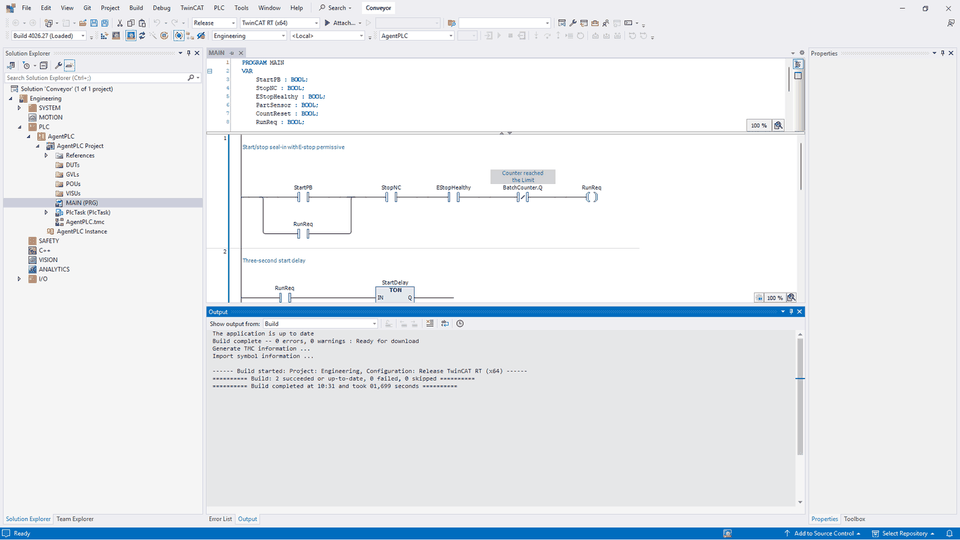

# TwinCAT RT (x64): agent-authored conveyor

This example was created through **multi-plc-agent's Beckhoff MCP backend**, not by manually drawing the ladder. It is an offline software-PLC engineering example, **not CX7000 hardware support**.

## Files

- [`request.json`](request.json): original reusable variables and six LD rungs.
- [`native/Conveyor.sln`](native/Conveyor.sln): original native solution and source-only project. Generated libraries/compiler caches are excluded; use your own licensed installation and resolved standard libraries.
- [`native-evidence.json`](native-evidence.json): sanitized actual router write/export/rebuild results.
- [`native-evidence.gif`](native-evidence.gif): two privacy-reviewed actual native step captures, not a continuous recording or simulation.

## Behavior and signals

`MAIN` runs in cyclic `PlcTask` at **10 ms**. All signals below are logical BOOL variables, **not physical terminal addresses**.

| Signal | Meaning |
| --- | --- |
| `StartPB` | Start request |
| `StopNC` | Stop permissive; TRUE means the stop circuit status is healthy |
| `EStopHealthy` | E-stop status permissive; ordinary PLC logic, not a safety-rated function |
| `PartSensor` | The CTU counts rising edges of `Motor AND PartSensor`; see the restart limitation below |
| `CountReset` | Reset the batch counter independently of the motor command |
| `RunReq` | Internal seal-in request, inhibited at batch complete |
| `Horn` | Warning during the three-second start delay |
| `Motor` | Motor command after the delay; drops on stop, lost permissive or batch complete |
| `BatchLamp` | Counter-complete indication |

Instances `StartDelay : TON` and `BatchCounter : CTU` are generated from the rungs. The preset is `T#3S` / `10`. Resetting the batch does not itself create a new start request. Native compilation proves engineering acceptance only; runtime timing, sensor behavior, scan transitions and physical stopping remain untested. Use appropriate independent safety hardware before any real machine work.

### Measured restart limitation

The [OIP conveyor pilot](../02-oip-conveyor/) reproduced a contract-equivalent IEC run in which a photoeye held TRUE was counted again when the motor restarted: the CTU input falls with `Motor` and rises again without a new physical sensor edge. This is a measured simulation boundary, not a new native runtime result. Example 02 separates the physical sensor edge from the motor permissive and includes a failing-before/passing-after regression. This original six-rung engineering fixture and its native evidence remain unchanged.

## Recreate through the agent

1. Configure the [Beckhoff backend](../../../backends/beckhoff/) with an explicit scratch workspace and `--allow-write`; enable its `twincat` entry in the router.
2. Give the agent this instruction:

   > Read request.json from this example. Call beckhoff_validate with its variables and rungs. If valid, call beckhoff_write_ladder with the same data and a fresh workspace-relative path Trial01/Conveyor.sln. Do not draw the LD manually, change software installations, activate a runtime, connect/download to a PLC, or claim a simulation result. Then call beckhoff_export_pou and beckhoff_build in fresh hosts. Report native error/warning and failed-project counts separately, and require the exported LD, declarations and MAIN/PlcTask/10 ms binding to match.

3. Inspect `ok`, `saved_closed_reopened`, `logic_matches`, `declarations_match`, `task_bound`, `platform_matches`, native counts and `owned_host_exited`. A missing count or readback mismatch is not a pass.
4. Use a new project directory for another trial. Replacing an existing backend-owned directory requires explicit `overwrite=true` and an unused sibling `.bak` destination. Do not overwrite the bundled source example just to run a trial.

To inspect the supplied project directly, open `native/Conveyor.sln` in the licensed XAE Shell, select **Release / TwinCAT RT (x64)** if necessary, and build. Standard libraries must resolve; no vendor library binary is bundled. Build regenerates the excluded TMC/compiler caches. Opening/building is not permission to activate a configuration, start a runtime or download.

## What was actually proved

On 2026-11-03, XAE build **4026.27** / PLC integration **7.1.3**:

- Router-authored native LD, save/close/reopen and native build: **0 errors, 0 warnings, 0 failed projects**.
- Independently reopened/exported in a second native process; all six rungs, nine BOOL declarations, TON/CTU instances and 10 ms task binding match.
- Rebuilt in a third fresh native process: **0 errors / 0 warnings**.
- All three owned hosts exited; no online PLC operation was invoked.

**Not proved:** simulation, Factory I/O, ADS/live values, physical I/O mapping, a physical PLC, CX7000/ARM or functional safety. HMI-AI remains a separate read-only consumer; no live binding or native HMI writer is implied.
