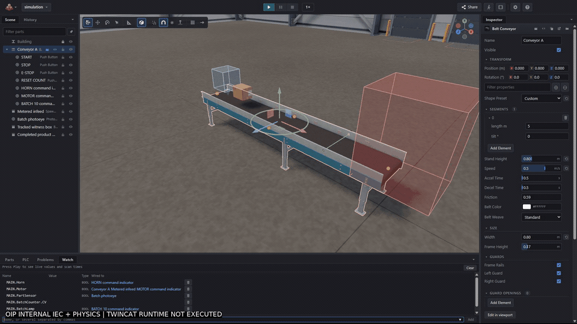

# Beckhoff LD + Open Industry conveyor pilot

This example contains **native TwinCAT x64 LD**, an **independently tested Open Industry Project (OIP) IEC/physics model**, and real external **OpenPLC v4.3.2** and **Beckhoff Usermode Runtime** closed loops. They implement the documented control contract. OIP supplies the physical world and probes; it does not execute the native TcPOU in the ADS run. This is not CX7000/ARM support, a physical-I/O test or a safety certification.

## Measured results

| Gate | Actual result |
| --- | --- |
| Real OIP desktop MCP | Initialize, 58 tools, project/part writes and independent saved readback |
| Native LD | 8 rungs, 14 ordinary variables plus TON/CTU; MAIN/PlcTask at 10 ms |
| Native engineering | Save/close/reopen; 0 errors / 0 warnings / 0 failed projects |
| Independent native check | Fresh-host export matches logic, declarations and task; another fresh host builds with 0 errors / 0 warnings |
| OIP process acceptance | 9 scenarios, 54 checks passed using actual Jolt physics |
| Negative control | Removing the E-stop permissive in a separate project is rejected by motor and physical-position assertions |
| Live internal batch | Counter 10, batch lamp TRUE, motor FALSE and actual belt-running feedback FALSE |
| OpenPLC external loop | Real v4.3.2 native compile and wall-clock Modbus TCP: the same 9 scenarios / 54 checks passed; 37,945 requests, zero protocol exceptions |
| Beckhoff external loop | Licensed UserModeRuntime 1.27.1; native PLC 851 RUN during the recorded suite; one complete wall-clock run passed the same 9 scenarios / 54 checks; earlier timing failure retained |
| Physical PLC / terminal mapping | Not tested |

Native results are in [native-evidence.json](native-evidence.json). Process checks, traces, regressions and precise scope are in [process-evidence.json](process-evidence.json). No online operation was invoked by the native engineering backend.

External results are in [openplc-evidence.json](openplc-evidence.json), with per-scenario tag transitions and physical cargo observations in [openplc-traces.json](openplc-traces.json). These come from the real external PLC, not the in-process IEC evaluator. The OpenPLC control statements are unchanged; I/O variables are located for Modbus, RunReq is observable in the output image and CountValue mirrors the actual CTU CV for observation. This adapter does not make an independent formal equivalence proof.

Native results are in [beckhoff-evidence.json](beckhoff-evidence.json), with actual tag transitions and cargo observations in [beckhoff-traces.json](beckhoff-traces.json). [Independent artifact identity](beckhoff-native-identity.json) matches the published MAIN source to the private native build and the compiled boot app to the active target's boot app. The kernel-local runtime stayed CONFIG; no physical outputs were mapped.

The first native transfer smoke passed seven checks but missed the motor/horn deadline at 3.7 s; Motor became TRUE at 3.783 s. A later complete run passed without changing the controller, task or canonical assertions. The [standalone timer probe](beckhoff-clock-evidence.json), with physics absent, also measured divergence between the 3000 ms PLC timer and host wall time. Beckhoff [does not guarantee deterministic usermode execution](https://infosys.beckhoff.com/content/1033/tc170x_tc3_usermode_runtime/11319889035.html). A finite passing run is not a hard-real-time guarantee; the initial failure is not discarded.

The operator closed the dedicated lab runtime after testing finished. That subsequent shutdown does not invalidate the saved results; they document a completed run, not current runtime availability. A new ADS replay requires the dedicated, licensed target to be running again. No failed scenario is inferred from the operator closing it afterward.

## Actual recording



The GIF is a reviewed 5 fps recording derived from the actual approximately 30.8-second live desktop run. Its scope watermark is deliberate. The full H.264 MP4 (1920x1080, 30 fps, no audio) is kept locally rather than bundled in Git. This is neither a rendered storyboard nor evidence of TwinCAT execution. The horn is represented by a command indicator, not an acoustic model.

## Files

- [native/Conveyor.sln](native/Conveyor.sln): agent-authored native solution; generated libraries, boot binaries and caches are excluded.
- [request.json](request.json): eight LD rungs and typed variables submitted through multi-plc-agent's actual Beckhoff MCP backend.
- [simulation/](simulation/): saved, portable OIP project with its own part definitions, controller and nine acceptance specifications.
- [contract.json](contract.json): timing, ownership, sensor edge and fault scope.
- [signal-map.csv](signal-map.csv): logical names and ADS symbols exercised on the dedicated usermode target; no physical terminal addresses are verified.
- [recipe.json](recipe.json): semantic part names, placement, mounts and template IDs for agent recreation.
- [run-mcp.mjs](run-mcp.mjs): dependency-free Node client that recreates the scene through MCP, remaps IDs, saves/runs the actual tests and can verify the negative control on a separate project.
- [run-runtime.mjs](run-runtime.mjs): explicit-opt-in real-runtime adapter using the same saved specifications, OIP world probes and assertion evaluator. Both OpenPLC and ADS modes were exercised. ADS cleanup writes stop/reset inputs and verifies inactive motor/horn/run request and counter zero before closing the connection. It never activates or downloads a Beckhoff configuration.
- [source-files.json](source-files.json): SHA-256 pins for this example's source/evidence files.
- [runtime-prerequisites.json](runtime-prerequisites.json): exact runtime/compiler versions, npm pins, verified installer digest, official trial outcome and retained failed prerequisites.
- [beckhoff-native-identity.json](beckhoff-native-identity.json): source/boot digests, actual native symbol declarations and guarded usermode load identity; no vendor binary or license payload.
- [beckhoff-evidence.json](beckhoff-evidence.json) and [beckhoff-traces.json](beckhoff-traces.json): complete native scenario receipt and measured physical-world observations.
- [beckhoff-clock-evidence.json](beckhoff-clock-evidence.json): native timer/host-clock measurements and the non-real-time limitation.

## Controller and rung order

| Rung | Function |
| --- | --- |
| 1 | Start/stop seal-in, healthy E-stop permissive and stop at batch complete |
| 2 | TON start delay, 3 seconds |
| 3 | Horn command during the delay |
| 4 | Motor command after the delay |
| 5 | PartPulse from PartSensor AND NOT LastPartSensor |
| 6 | Remember PartSensor every scan, including when stopped |
| 7 | CTU preset 10, counting Motor AND PartPulse, with independent CountReset |
| 8 | Batch-complete lamp |

The edge memory is essential: gating a CTU directly with `Motor AND PartSensor` recounts an unchanged TRUE sensor when the motor restarts. The pilot first reproduced count **2 instead of 1**, then passed the same regression after separating the physical edge. The [original six-rung example](../01-twincat-rt-x64-conveyor/) retains its engineering fixture and documents that limitation.

StartPB is still a level-sensitive seal-in input, not a restart-inhibit safety function. Release StartPB before restoring a permissive. Reset alone does not start the conveyor. EStopHealthy is ordinary simulated status, not a substitute for safety hardware.

## Recreate through an agent

Use the pinned OIP source revision recorded in process-evidence.json, Node >=24, and the official desktop MCP. An installed app enables it through Help > Agent Connections. The measured run used a Windows source development shell with an owned profile and a dedicated port; unpackaged mode does not run the installed app's auto-updater. No second Windows account or VM is required.

From this directory in Windows PowerShell, with the desktop MCP already serving:

```powershell
node .\run-mcp.mjs --url http://127.0.0.1:5189/mcp --create ConveyorPilot01 --negative --out .\proof-run01
```

Choose a fresh project name. `--create` authors every part, mount, program and test through MCP; it does not hand-edit scene.json. `--negative` makes a separate project, removes exactly one E-stop gate, requires a real behavioral failure, then reopens the positive project. Outputs contain actual JSON-RPC requests and replies. This client labels its expected engine revision but cannot independently prove the desktop binary's source SHA.

To test a project already present in the app instead:

```powershell
node .\run-mcp.mjs --url http://127.0.0.1:5189/mcp --project "D:\path\to\simulation" --out .\proof-existing
```

Neither command activates, downloads to or starts a vendor PLC. Do not mistake an empty test set for success: the runner refuses it. The actual packaged CLI was smoke-tested by recreating a fresh scene, passing all nine scenarios and rejecting the mutant.

## Acceptance scenarios

The canonical specifications are the files listed by [simulation/project.json](simulation/project.json) under [simulation/tests/](simulation/tests/).

| Case | Checks |
| --- | --- |
| Start and transfer | Horn timing; motor delay; actual tracked-box motion, sensor arrival, target zone and no exit spill |
| Stop and recovery | Command drop, physical coasting/stop, no unrequested restart and a fresh warning period |
| E-stop and recovery | Same process checks, with the E-stop status permissive |
| Stop during horn | Cancelled start; no motion until the next request and delay |
| Batch ten/reset | Ten sensor edges and actual zone entries; stop/lamp; reset without a new run |
| Sensor stuck HIGH | One count while held, physical traffic still occurs, and counting resumes after release |
| Jam/release | A real cargo body is physically pinned and subsequently reaches the target |
| Communication loss/recovery | Internal safe-off I/O fault causes a stop; recovery alone does not restart |
| Sensor held across restart | No duplicate count without a new physical photoeye edge |

Jam and stuck-sensor tests describe measured consequences; this controller does not add a diagnostic fault latch. Communication loss is OIP's explicit `inputs=off, outputs=off` test injection, not a measured ADS disconnect or proof of hold-last network safety. The live PLC watch is sampled; short pulses can be missed in its display. Headless assertions and the physical probes carry the verdict, not the video alone.

The standalone CLI also passed all nine saved tests (54 checks) after validating the portable project. Its jam/release trace reported a 17 ms photoeye clear flicker between blocked periods. This example has no sensor debounce; the normal ten-item batch passed, but accurate physical-product counting under sensor chatter is not established.

## External runtime prerequisites

After explicit operator approval, OpenPLC Runtime **v4.3.2** was installed per user, without administrator elevation, Docker or a new Windows account. The official release installer SHA-256 was verified before execution. A private first lab account was created on a fresh local SQLite database. Credentials are not bundled here. The local process wrapper restricts Python listeners to loopback; it does not alter PLC code, protocol data, authentication or assertions.

The OpenPLC editor compiler was pinned to `Autonomy-Logic/openplc-editor@13fee913d66fb4d93f7528c3359144819da1c275`, with STruC++ **v0.6.7**. Required package versions were preflighted before installation with lifecycle scripts suppressed. Compiler sources, generated runtime bundles and GPL headers remain outside this public example.

The existing TwinCAT installation contains UserModeRuntime **1.27.1**. A separate owned instance, profile and native-built boot copy were used; its identity differed from the kernel-local target. Initial activation/restart attempts reverted to CONFIG with ADS 851 code 6 and an actual **“license not found”** error. Those failures remain recorded; command acknowledgement was never treated as execution.

A read-only plan for **TwinCAT.XAR.PLC 2.4.12** reported administrator privileges required, usermode compatibility and no declared system-service restart, test-mode or Beckhoff-hardware requirement. The operator approved the exact package and an official TC1200 trial, but Windows canceled the normal UAC request before the elevated installer started. **No package was installed**, no alternate elevation route was attempted and the kernel/restart wrapper was not selected. The subsequent licensed usermode run succeeded without that additional package; its absence was not the demonstrated cause.

After an initial cancellation, the operator explicitly requested the official manual route: **SYSTEM → License → Manage Licenses → Order Information (Runtime) → 7 Days Trial License**. Automatic detection remained enabled and the table listed only **TC1200 / TC3 PLC** as missing. The operator personally entered and submitted the verification code; the agent did not transcribe or submit it. A normal trial response appeared inside the private target. Guarded SDK activation/restart then reached RUN on system port 10000 and PLC port 851, and actual ADS symbols and process behavior were exercised. Trial payloads, device identifiers and the private licensing screenshot are not bundled.

No kernel runtime configuration, Hyper-V/VBS or driver was changed. The offline MCP backend deliberately exposes no activation/download tools; these explicitly approved lab SDK/UI actions remain separate. See [Beckhoff's usermode licensing requirements](https://infosys.beckhoff.com/content/1033/tc170x_tc3_usermode_runtime/11319883275.html) and [official trial activation procedure](https://infosys.beckhoff.com/content/1033/tc3_licensing/3510308491.html).

## Reproduce the real external loop

Prerequisites: the pinned OIP checkout and its existing Node >=24 dependencies, cached pinned OpenPLC editor/compiler dependencies, an already provisioned **dedicated loopback lab runtime**, and a private JSON credential file containing `username` and `password`. Review/preflight the exact package closure in [runtime-prerequisites.json](runtime-prerequisites.json) before dependency preparation. From the OIP checkout, the upstream preparation entrypoints are:

```powershell
node --input-type=module -e "const m=await import('./scripts/lib/openplc-editor.mjs'); await m.ensureEditorSources(m.UPLOAD_ENTRIES); console.log(await m.ensureDeps());"
```

This downloads the pinned compiler sources and installs its declared cache dependencies with lifecycle scripts suppressed. It does not start a PLC. The example runner below is deliberately offline for dependency preparation; it never silently installs packages or creates accounts.

The upstream login helper can provision a first account; this runner explicitly blocks that account-creation request. An empty account store is refused before PLC stop/deploy actions. A bounded pre-publication probe reproduced the earlier creation attempt, then verified refusal without an account-creation or stop request; the corrected runner also passed an actual compile/transfer smoke with an existing lab account.

From this example directory, adapt the three operator paths:

```powershell
node .\run-runtime.mjs openplc "D:\path\to\Open-Industry-Project" https://127.0.0.1:8443 "D:\private\oip-loop-proof" --credentials "D:\private\openplc-lab.json" --allow-lab-write
```

This explicitly stops the selected lab program, uploads/builds the located conveyor and executes the saved scenarios against real wall-clock PLC scans and paced 60 Hz physics. It stops the PLC afterward. Never use a runtime controlling equipment. Keep the output and credentials outside the public example; the output contains compiled runtime material that must not be bundled as repository source.

`--only TEST_FILE` selects one canonical file and refuses an empty match. The published entrypoint was separately smoke-tested on the actual runtime, not only syntax-checked. The nine-case receipt above is from the complete actual run. Communication-loss case 08 is still the saved **safe-off I/O injection**, not a TCP disconnect. No network-loss fail-safe behavior is inferred.

The ADS mode requires an explicit non-kernel-local usermode NetId, an already running native PLC, `--allow-lab-write` and an external output directory. It exchanges simulated operator/sensor inputs and reads native symbols; it does not install, license, activate, download or change vendor runtime modes. On success or failure after binding, it writes stop/reset inputs and waits for verified inactive commands and counter zero before closing ADS. Cleanup failure is an error, not a silent success. This is a software-model postcondition, not a safety-rated stop.

For an already provisioned dedicated target, set `OIP_UM_NETID` to its actual non-kernel-local NetId, then run:

```powershell
node .\run-runtime.mjs beckhoff "D:\path\to\Open-Industry-Project" "$env:OIP_UM_NETID" "D:\private\oip-beckhoff-proof" --allow-lab-write
```

## Rights and safety

This repository's original example code is Apache-2.0. Bundled first-party OIP scene parts and the runtime harness's reused OIP loop/probe interfaces retain the upstream MIT notice in [simulation/OIP-LICENSE](simulation/OIP-LICENSE). No proprietary DLL, vendor library, installer, GPL runtime bundle or paid Factory I/O asset is included. Product names identify connection targets, not sponsorship or certification. Never connect this educational example to machinery without independent engineering and safety validation.
