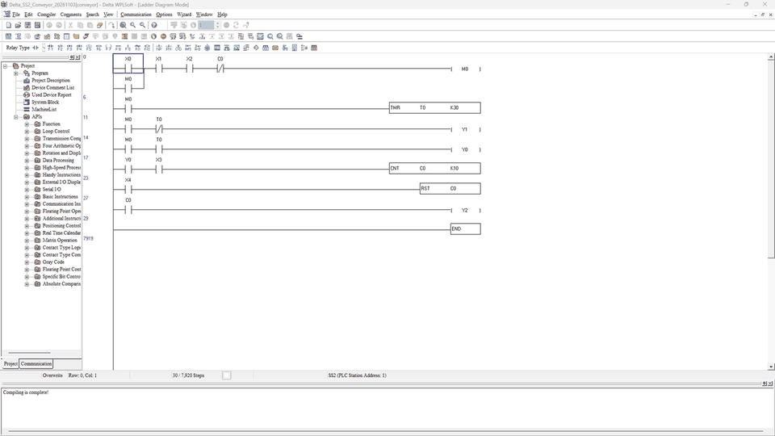

# Delta DVP-SS2: agent-authored conveyor

This example uses the existing **WPLSoft MCP backend**, through multi-plc-agent. The user explicitly selected DVP-SS2/WPLSoft instead of the still-unverified DVP28SV3/DIADesigner path. It does not add another PLC family to the support count.

## Files and native proof

- [request.json](request.json): seven original rungs and eleven device aliases.
- [native/Delta_SS2_Conveyor_20261103.dvp](native/Delta_SS2_Conveyor_20261103.dvp): project authored by MCP and saved through WPLSoft 2.52.0.0; no manual rung entry.
- [program.il](program.il): the saved instruction list, including END.
- [native-evidence.json](native-evidence.json): actual router validation/write/readback/recompile results, sanitized to remove machine paths. WPLSoft returned **0 grammar errors**, with `Diagram is complete!`; a separate warning count is not available and is not claimed.
- [source-files.json](source-files.json): hashes binding the request, native project and readable IL.
- [native-evidence.gif](native-evidence.gif): two reviewed actual native step captures: LD and the saved instruction view, with `Compiling is complete!`. This is not a continuous authoring recording or simulation.

The native project family is **SS2**. No exact physical ordering code, transistor polarity, field wiring, simulation or PLC hardware has been verified. Open the supplied `.dvp` in your licensed WPLSoft installation to inspect the complete ladder offline. Do not download it to a machine without an independent engineering and safety review.

## Signal contract

| Address | Meaning | Polarity / time base |
| --- | --- | --- |
| X0 | Start pushbutton request | TRUE requests start |
| X1 | Stop status permissive | TRUE means healthy; FALSE drops the run request |
| X2 | E-stop status permissive | TRUE means healthy; ordinary PLC logic, not a safety-rated function |
| X3 | Product sensor | Rising edges counted while the motor is commanded on |
| X4 | Batch reset | Resets C0 independently of motor command |
| M0 | Internal run seal-in | Inhibited by C0 batch completion |
| T0 | Start delay | 100 ms timer base; K30 = 3 seconds |
| C0 | Batch counter | K10 products |
| Y0 | Motor command | M0 and T0 complete |
| Y1 | Warning horn | M0 and not T0 complete |
| Y2 | Batch-complete lamp | C0 complete |

Rung order: run seal-in -> start delay -> horn -> motor -> count -> reset -> batch lamp. The count contact inhibits the next run-request evaluation after batch completion. Reset takes effect at its own rung; scan-cycle transitions, timer accuracy, actual product sensing and physical stopping are **not runtime-tested**. Reset does not by itself create a fresh start request, although a held start button is a continuing start request. Rung descriptions live in request.json; the backend stores device aliases but does not write WPLSoft segment comments.

## Recreate through MCP

1. Enable the existing `delta` entry from [config.example.json](../../../config.example.json), using an existing Windows Python with the documented desktop dependencies and WPLSoft 2.52. No new software/account/VM is required by this example.
2. Use a dedicated scratch destination that does not already exist. Ask the agent:

   > Read request.json. Call delta_validate with its rungs and aliases. If valid, call delta_new_project with template SS2 and a fresh absolute .dvp path. Then call delta_write_ladder with that path and exactly those rungs/aliases. Require native `ok`, `saved`, `il_matches` and zero grammar errors. Call delta_read_il to compare the saved instructions and device aliases, then delta_compile to reopen/check the saved project in another owned WPLSoft process. No online, simulation or physical PLC operation is authorized. Do not ask me to draw ladder manually.

3. Preserve the native return values and source hashes. A generated file or self-check alone is not acceptance. A displayed zero without a completed native check is not a pass.
4. Inspect the native project; do not overwrite the bundled example during trials. `new_project` refuses an existing destination. Existing backend `write_ladder` replaces its whole program and keeps `.bak`; choose a fresh trial file to avoid replacing earlier work or its backup.

## Scope

Observed: real router calls, native Instruction -> Ladder conversion, native save, matching saved IL/aliases, reopening/recompile and native visual inspection. Not observed: simulator execution, hardware, Factory I/O, a certified safety function, DVP28SV3 or DIADesigner LD support. HMI-AI remains a separate read-only consumer; no HMI writer or live Modbus/ADS binding is implied.
